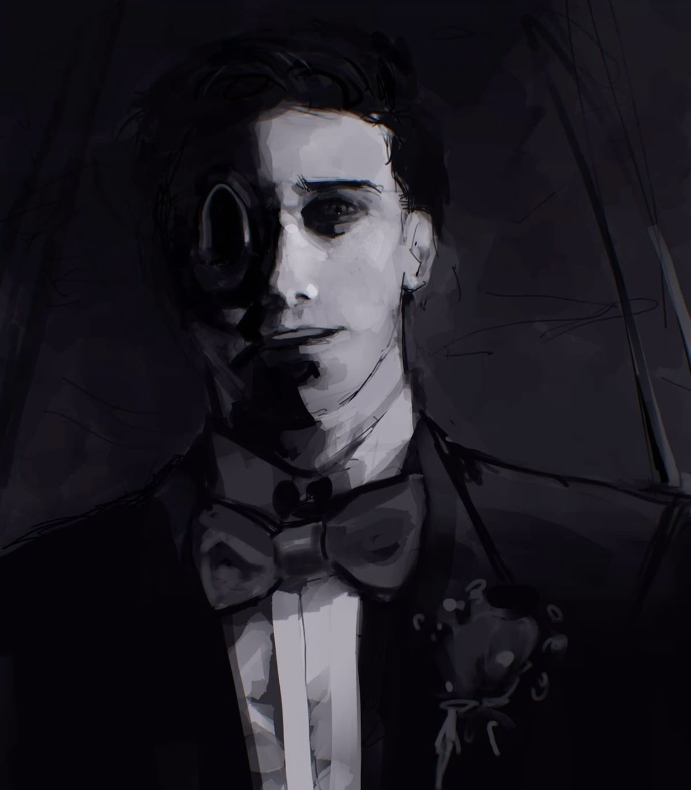
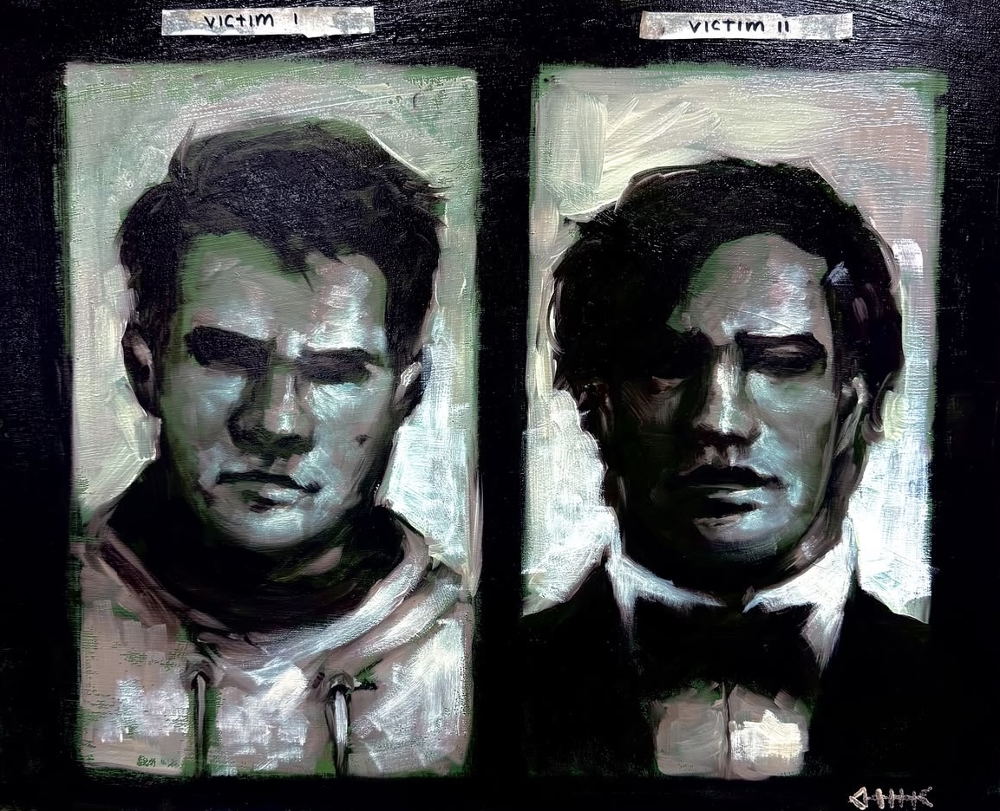

# CESAR / EVAN 

**18** · he/him · they/them

> " You need to open the door NOW… I am not going away. " 🌹

---

## about

I have recently turned 18 years old, and I’m interested in gaming, movies, ARGs, and analog horror.

I’m an introvert and quite awkward when it comes to social interactions. I rarely interact first, so it’s better not to wait for me to do that. Despite this, I love when people whisper to have a conversation, as I’m much more open in private most of the time.

**Always C+H and W2I.** I might reply in public chat too, depending on how I’m feeling. I’m a multishipper, no matter the fandom, so idm ships as long as they’re not problematic, same with yumeships. 

I thrive on dark humor and insults as my way of joking around, but I do use tone tags with people I’m not close to. If I say something that seems borderline rude, take it as me forgetting to use tone tags—it’s quite possible. I wouldn’t go out of my way to start arguments or drama in public anyway.

---

## boundaries

- Respect my interaction boundary tags
- Do not copy, screenshot, or post any of my ponies
- Don’t assume I’ll immediately friend you; I’m very selective
- Do not try to flirt with me, keep it as a joke, I have a boyfriend

## dni

- Rude or disrespectful people
- Manipulative or pushy behavior
- Intimidation or pressure
- RusAme shippers (sorry Hetalia fans I fucking hate it 😣)
- Darkshippers with no intention of changing in the future
- Proshippers
- People interested in me only for something they want
- Carmen (PMOON) fictionkins; I’m a Carmen fullfic

## ints

- Anyone in my same fandoms who also is NOT problematic

## fandoms

- The Mandela Catalogue
- everymanHYBRID
- Marble Hornets
- Creepypasta
- Mononoke
- GNOSIA
- Search for the Leviathan
- Brawl Stars
- The Mimic
- Forsaken (partly)
- Animal Hospital
- Anomaly Café
- Steven Universe
- Cookie Run: Kingdom
- Danganronpa
- Don’t Hug Me I’m Scared
- Persona 5
- Backrooms (2026 movie and non-movie versions)
- Obsession (2026 movie)
- Hokum (2026 movie)
- Limbus Company / Library of Ruina / Lobotomy Corporation — main interests
- Helluva Boss (partly)
- Hetalia
- South Park
- Warrior Cats
- Among Us Show
- Among Us Logic
- Alice in Wonderland (2011 movie)
- Dandy’s World (partly; kinda inactive)
- Zombie Stage
- Jackpot Crash Course
- Rot in Paradise
- Married in Red
- Dead Plate
- Cold Front
- Eloquent Countenance
- Elevator Hitch
- Regretevator

---

> " Uh oh, bad decision, Mark! " 🌹

